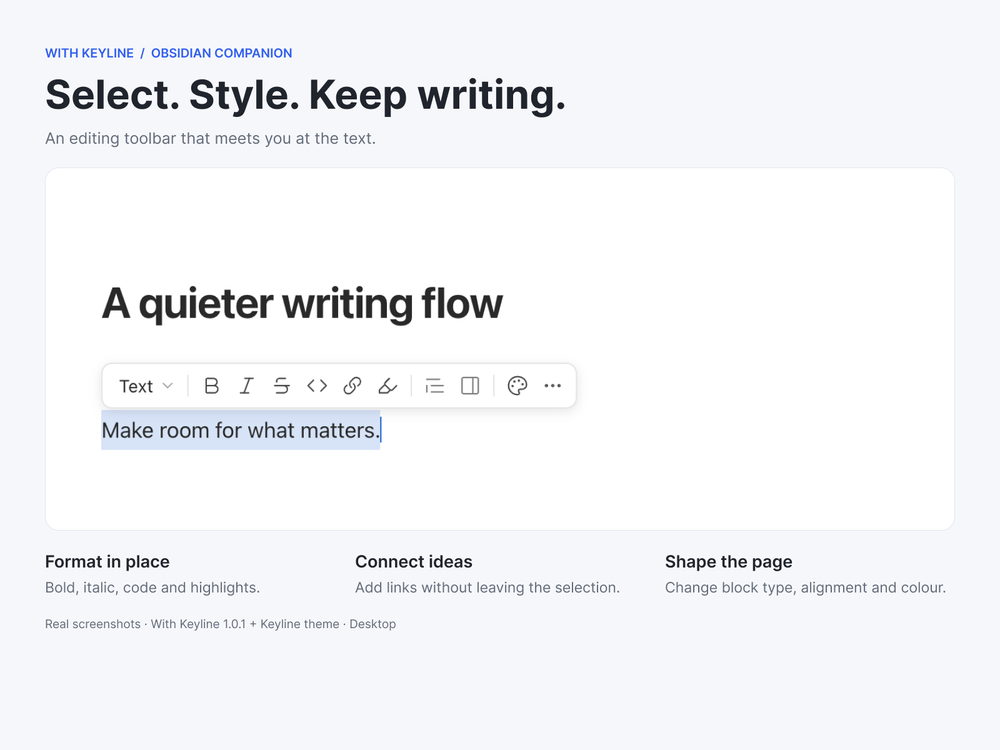
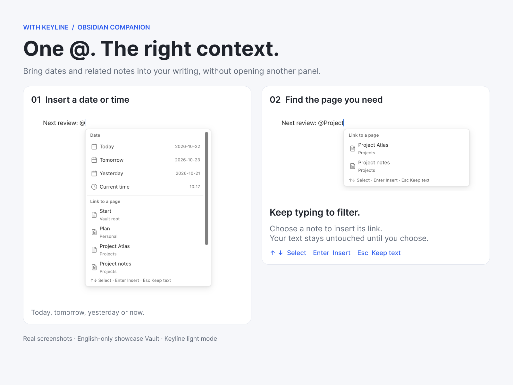

# With Keyline

**Less setup. More writing.**

Pair With Keyline with the [Keyline theme](https://community.obsidian.md/themes/keyline) to make Obsidian feel ready to use. The theme supplies the visual foundation; this companion brings everyday tools to the text, files and workspaces you are already using.

[中文](README.zh-CN.md) · [Community](https://community.obsidian.md/plugins/with-keyline) · [Downloads](https://github.com/BADtoBad/with-keyline/releases) · [Report a bug](https://github.com/BADtoBad/with-keyline/issues)

## Your tools, where you need them

- **Select text and keep writing.** A compact toolbar appears beside your selection for formatting, links, colours and block types. Keep the selection while applying more than one action.
- **Work with blocks.** Hover for an insert button and drag handle. Move paragraphs and nested lists with their contents; undo supported edits through Obsidian. Native collapse arrows stay clickable beside the handle.
- **Type `@` for pages and dates.** Search notes or insert today, tomorrow, yesterday and the current time. Chinese text can lead directly into `@`. Continue typing to filter; nothing is replaced until you choose an item.
- **Insert without breaking your flow.** Use `/` or the plus button for headings, lists, tasks, callouts, links, images and attachments. Reorder or hide menu items and add registered commands.
- **Know your files at a glance.** The original Keyline filled/sharp icon family distinguishes notes, folders and file types in the native sidebar and document tabs. Give individual files their own icon and colour. Folder expansion stays in the same icon slot.
- **One coordinated writing surface.** Tune text width, paragraph rhythm, list indentation and headings from six clear settings categories: tabs on the left, options on the right. English and Chinese are built in.
- **Switch the whole working context.** With core Workspaces enabled, switch saved layouts from a compact control, with a verified recovery snapshot before a switch.

## Previous Keyline companion

With Keyline is an independently implemented successor to the integrated [Keyline interactions plugin](https://github.com/BADtoBad/keyline-interactions). **Their main everyday features are broadly equivalent**, with some safety and implementation differences—not byte-for-byte behaviour or settings compatibility.

**If you encounter a bug in With Keyline, try the [previous GitHub version](https://github.com/BADtoBad/keyline-interactions/releases) as a fallback.** It remains available and is not replaced by this release. Disable With Keyline before enabling the previous plugin; do not run both together. They have separate settings, and switching does not automatically migrate them. Report the failing action and versions so the new implementation can improve.

## Install

Open the [With Keyline Community page](https://community.obsidian.md/plugins/with-keyline) for the current release and installation entry, or search **With Keyline** in Obsidian's Community plugins. Manual installation is also available from [GitHub Releases](https://github.com/BADtoBad/with-keyline/releases):

1. Back up your Vault's `.obsidian` configuration and disable the previous Keyline companion if installed.
2. Create `.obsidian/plugins/with-keyline/` and copy `main.js`, `manifest.json` and `styles.css` from the same release.
3. Reload Obsidian and enable **With Keyline** under Community plugins.
4. Install the **Keyline** theme separately for the intended visual pairing. The theme does not install this plugin automatically.

No personal notes, demo workspace or old settings are installed automatically. Optional settings import is described in [MIGRATION.md](MIGRATION.md). Keep licences and notices with redistributed copies.

## Compatibility and privacy

- **Desktop only; Obsidian 1.13.7 or newer.** The primary tested combination is macOS, Obsidian 1.13.7 and Community Keyline 0.8.24. Mobile editing is not supported by this release. Other desktop systems and third-party combinations need their own checks.
- File icons identify formats; they do not add EPUB or other file readers. Workspace actions require core Workspaces. Iconic retains ownership when enabled.
- No telemetry or plugin-owned network requests. Settings and recovery data stay in the Vault configuration. User-invoked host commands and other plugins retain their own behaviour.
- Formatting and block commands can change selected note content. Imported files and newly created notes are retained when you undo their inserted links; they are not silently deleted.
- See [release verification](RELEASE-VERIFICATION.md) for the tested scope. Automated checks are not a promise of zero bugs.

## Build and licence

Use Node 22+ and the package-manager version pinned in `package.json`: `pnpm install --frozen-lockfile`, then `pnpm verify`.

MIT. See [LICENSE](LICENSE), [third-party notices](THIRD-PARTY-NOTICES.txt) and [implementation provenance](PROVENANCE.md). The original Keyline Icons artwork keeps its attribution; the runtime is a reference-informed independent implementation, not a claim of formal clean-room certification.
